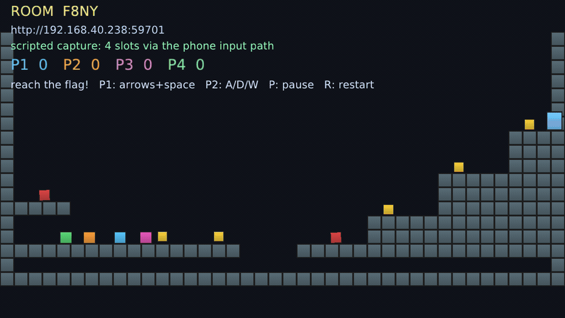

# plyEngine

**A 2D game engine for C++ where players join from their phones — no app, no
accounts, no build step to try it.**



*Scripted capture of the reference platformer: four controller slots driven
through the engine's real phone input path.*
[The controller that runs on the phone](docs/announcements/hero-controller.png)

## Try it in 30 seconds

No account, no compiler, no form. Download the archive for your OS from
[Releases](https://github.com/plyndra/plyEngine/releases/latest), unpack it, run
it, and open the printed URL on your phones (same Wi-Fi).

```sh
# Linux x86-64 (glibc 2.35+, desktop OpenGL 3.3)
tar xzf plyEngine-v*-linux-x86_64.tar.gz && cd plyEngine-v*/
./ply_companion           # prints a room code and a LAN URL

# macOS (Apple Silicon)
tar xzf plyEngine-v*-macos-arm64.tar.gz && cd plyEngine-v*/
xattr -dr com.apple.quarantine .   # unsigned build: clears Gatekeeper
./ply_companion

# Windows x64: extract the .zip, then in PowerShell
.\ply_companion.exe
```

Four phones become P1–P4 for the platformer (coins, patrolling saws, a pit, a
staircase, a flag — first to the flag wins, with sound cues for jumps, coins,
deaths and the win). No phones? Keyboard works: P1 arrows + Space, P2 A/D/W,
`P` pauses, `R` restarts. `./ply_tutorial` is the game from
[docs/TUTORIAL.md](docs/TUTORIAL.md), built step by step.

## Use it in your project

The engine is one CMake target; C++20, include paths and dependencies
propagate. Pin the tag you tested:

```cmake
include(FetchContent)
set(PLY_BUILD_TESTS OFF CACHE BOOL "" FORCE)
set(PLY_BUILD_EXAMPLES OFF CACHE BOOL "" FORCE)
FetchContent_Declare(plyEngine
    GIT_REPOSITORY https://github.com/plyndra/plyEngine.git
    GIT_TAG        v1.0.0)
FetchContent_MakeAvailable(plyEngine)
target_link_libraries(mygame PRIVATE plyEngine)
```

Or from an installed SDK / package manager:

```sh
cmake --install build --prefix /opt/plyengine   # then: find_package(plyEngine CONFIG REQUIRED)
vcpkg install plyengine --overlay-ports=ports   # in-repo registry; see packaging/
```

> **Status:** public API is frozen (additions are minor changes; removals or
> renames need a deprecation cycle). Behaviour can still change to fix a bug.
> Prebuilt binaries and source: [Releases](https://github.com/plyndra/plyEngine/releases).

## What you'll be able to build

- **2D games** — sprites, sprite atlases, orthographic camera, physics, audio.
- **Shared-screen party games** — the PC renders the game; each player controls
  it from their phone via a web browser / PWA.
- **Native desktop games** — Windows / Linux / macOS, OpenGL 3.3.

## Engine core

- **Archetype ECS** — cache-friendly component columns; entities carry
  generation-checked handles so stale references are detected.
- **Transform hierarchy** — parent/child composition with dirty-flag caching.
- **Fixed-timestep loop** — deterministic 60 Hz simulation with render
  interpolation, owned by `ply::App`.
- **Sprite batch renderer** — atlas-backed quads in a single draw call,
  centre-anchored, with per-texture filtering.
- **Asset pipeline** — PNG decoding, Aseprite/TexturePacker/generic spritesheet
  loaders, TTF text baked into an atlas, and a reference-counted asset cache.
- **Physics** — per-axis swept AABB collision against tilemaps, deterministic
  under the fixed timestep, with a spatial-hash broadphase.
- **Audio** — decoded sound effects with per-voice volume, pitch and pan.
- **Debug draw** — collider, tile-grid and body overlays for development.
- **Phone controllers** — embedded HTTP+WebSocket server, mDNS discovery, room
  codes, and a reference PWA so players join from a browser with no install.
- **Four-player reference demo** — coins, patrolling saws, a pit and a goal,
  with synthesised sound effects and four phones playing at once.
- **Lua scripting** — gameplay behaviour in Lua 5.4 against a small, sandboxed
  API (entity spawn/destroy, position, velocity, an `update(dt)` hook). No
  `io`, `os` or `debug`: a game script cannot touch the filesystem or the VM.

## Tech stack

| Layer | Choice |
|---|---|
| Language | C++20 |
| Foundation | SDL3 (window/input/audio/threading/filesystem, GL context) |
| Renderer | OpenGL 3.3 core, desktop only |
| ECS | Archetype (Bevy-style SoA) |
| Math | GLM |
| Companion | Crow (HTTP + WebSocket), versioned JSON protocol, mDNS, TypeScript + Vite PWA |
| Build | CMake + FetchContent (pinned) |
| Licence | MIT (DCO sign-off, no CLA) |

## Build it yourself

```sh
git clone https://github.com/plyndra/plyEngine.git
cd plyEngine
cmake -B build -DCMAKE_BUILD_TYPE=Release   # needs SDL3/X11 dev packages, see docs/BUILDING.md
cmake --build build -j
ctest --test-dir build --output-on-failure     # 15 headless suites
```

Full per-OS dependencies: [docs/BUILDING.md](docs/BUILDING.md). The walkthrough
that builds a game line by line is [docs/TUTORIAL.md](docs/TUTORIAL.md).

A source checkout needs the controller PWA built once
(`cd companion && npm ci && npm run build`); the release archives already ship
it. Each demo then runs interactively until you close its window:

```sh
./build/ply_hello          # batching + atlas + camera
./build/ply_ecs            # App + ECS + transform hierarchy
./build/ply_assets         # PNG + spritesheet JSON + TTF text
./build/ply_physics        # tilemap collision + debug overlay (F1)
./build/ply_tutorial       # the first-game walkthrough: docs/TUTORIAL.md
./build/ply_scripting      # drone behaviour written in Lua, rendered in C++
./build/ply_companion      # reference platformer, phone-controlled
```

## Verification

Every milestone ships with checks that can actually fail:

- **15 `ctest` suites** — ECS, transforms, timestep, atlas math, assets,
  physics, audio, scripting, companion protocol/server, and a scripted full
  playthrough of the reference platformer (`platformer`), all green in Release
  **and** under `-DPLY_SANITIZE=ON` (ASan + UBSan).
- **`--verify` on every demo** — headless assertions on real outcomes: the
  tutorial collects all five coins; `ply_companion --verify` plays a complete
  four-player match through the real companion-input queue and asserts coins,
  deaths, all four players moving independently, hazard patrol distance, the
  win state, and that the four sound cues were emitted and played.
- **CI** — Windows / Linux / macOS build matrix, a sanitizer job, Xvfb render
  checks, and the PWA build. Tagged releases additionally **unpack and run**
  the Linux archive on a clean Ubuntu 22.04 with no toolchain installed,
  assert the glibc floor, and build the tutorial from the published source
  tarball before anything is published:
  [Releases](https://github.com/plyndra/plyEngine/releases).

## Documentation

| Doc | What it covers |
|---|---|
| [docs/GETTING_STARTED.md](docs/GETTING_STARTED.md) | Build, test, run, play with phones |
| [docs/BUILDING.md](docs/BUILDING.md) | Per-OS dependencies, CMake options, sanitizers |
| [docs/TUTORIAL.md](docs/TUTORIAL.md) | Build your first game, step by step |
| [docs/DESIGN.md](docs/DESIGN.md) | Architecture and settled design decisions |
| [docs/ROADMAP.md](docs/ROADMAP.md) | Milestones and what's next |
| [CHANGELOG.md](CHANGELOG.md) | Release notes (Keep a Changelog) |

## Roadmap

M0 scaffold → M1 window → M2 renderer → M3 ECS → M4 assets → M5 simulation →
M6 companion → **M7 1.0-alpha (done)**. Post-1.0-alpha branches (scripting,
web build, mobile, internet play) are listed in
[docs/ROADMAP.md](docs/ROADMAP.md).

## Contributing

MIT-licensed, no CLA. Contributions use the
[Developer Certificate of Origin](CONTRIBUTING.md) (sign-off on every commit)
and follow our [Code of Conduct](CODE_OF_CONDUCT.md). Bug reports and feature
requests: [issue templates](https://github.com/plyndra/plyEngine/issues/new/choose).
