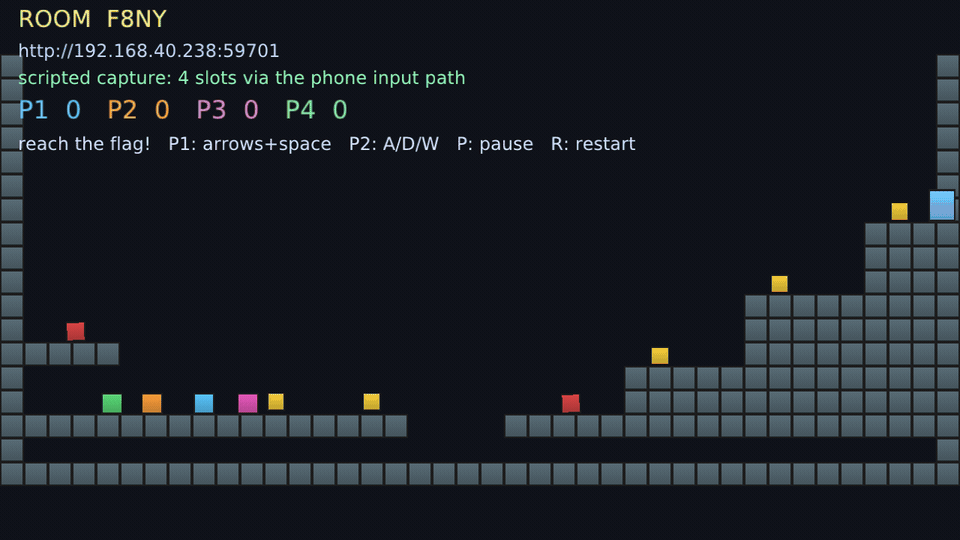

# Announcements — Discord copy and the incident write-up

**Status: unpublished draft.** Two artefacts: the `#showcase` message, and the
long-form incident write-up that the Discord message and any HN submission point
at. `[owner voice]` marks the two passages that must be *written* by the
maintainer rather than edited — the opening line and the closing ask. Everything
else here is either a measurement or a quote from this repository, and the audit
table at the end is the receipt list.

Assets in this directory: `hero-capture.gif` (19 s, four-slot scripted capture),
`hero-controller.png` (the real PWA joined to a live room),
`social-preview.png` (1280×640 card).

**The strongest material in the repo is a failure, not a feature.** The 0.46 s
demo death (incident 1) is fresher, self-implicating, and has a number attached —
so it leads, and the five incident titles are ordered by how much they cost.

---

## 1. Discord `#showcase` — the 60-second version

Constraints that shape it: one message per server, different days, answer every
reply, never cross-post the same day. Discord shows three lines in a phone
preview and people decide there, so the first sentence carries the whole message.
Attach `hero-capture.gif` — the animation does the explaining that a stack list
cannot.

### Choose the first line (then write the rest in your own words)

| # | First line | What it buys |
|---|---|---|
| A | `I shipped my 2D C++ engine at 1.0 yesterday. The first thing a downloader hit was a bug: every demo closed itself in 0.46 seconds.` | A number and an admission in line one; nobody scrolls past a self-inflicted wound. |
| B | `Four phones, no app install, no account — that demo is why I built this engine. What downloading it taught me cost more time than any feature I wrote.` | Leads with the thing only this engine does, then pivots to the incident. |
| C | `Green CI means someone ran the tests I wrote. It does not mean a stranger can start the binary. I learned that difference the hard way.` | Pure claim; works in technical servers, weaker in general gamedev ones. |

### Message body (hook line, then this)

```text
plyEngine — C++20 + OpenGL 3.3, MIT, 1.0 out yesterday. The reference demo puts
four players on one screen with their phones as controllers: no app, no account,
just a printed URL and a room code. Runs straight from the release archive.

[attach hero-capture.gif]

What I actually want from posting this: friction reports on the three paths I
cannot test myself — find_package after cmake --install, FetchContent, and
using the repo as its own vcpkg registry. 1.0 went out with zero outside build
reports, so that part is still unproven.

github.com/plyndra/plyEngine
```

Why this shape: the ask is *second*, not buried, because the plan's whole gate is
one non-owner build report. Roughly 75 words plus the hook.

---

## 2. Long form — the incident write-up

This is the durable artefact: Discord decays in a day, the write-up keeps working
from a profile, a comment, or a newsletter pitch.



*Scripted capture: four slots driven through the engine's real phone input path.
[The controller that runs on the phone](hero-controller.png).*

**In three lines, for the skim:** a solo-built C++ engine passed every gate it
had and shipped a demo that closed in 0.46 seconds; below are the five failures
that only appeared after download, each with the check that now catches it.

**Title options**

1. `Five things that broke only after people could download it`
2. `Every gate was green and nobody could start the binary`
3. `0.46 seconds: what a download revealed that CI could not`

**Opening** — `[owner voice]`, 2–3 sentences. It has to do one job: say you built
this yourself, say what it is in one clause, and admit the angle. Do not open
with "excited to announce"; the guideline lists in `../PROMOTION_PLAN.md`
and regression eval R6 both assume it will not appear.

---

### 1. The flagship demo exited in 0.46 seconds

The engine's whole pitch is "run it, open the URL on your phone". Every example
ended in `app.runFrames(frames > 0 ? frames : N)`, so a launch with no arguments
rendered 120 frames — as fast as the machine could go, not at 60 Hz — and quit.
`./ply_companion` printed a room code and died with it.

```console
$ time xvfb-run -a ./build/ply_companion --no-mdns
  room code: 6MWX

real    0m0.456s
```

Seven CI steps ran those same binaries and all were green. They all pass
`--frames`: `--frames 3 --verify`, `--frames 60 --verify`, `--frames 1800
--verify`, and so on. `smoke-linux` — which genuinely unpacks the published
archive on a toolchain-free container and executes it — passes `--frames 1800
--verify` too. Every gate measured the invocation the author uses, and none
measured the one the instructions give a stranger.

- **Lesson worth stealing:** a test that supplies arguments is not testing your
  README. Add one step that runs the binary exactly as a new user would, and
  require it to still be alive a few seconds later.
- **Fixed:** no-flag launch now means `app.run()` (interactive until the window
  closes); `--frames`, `--verify`, `--screenshot` keep the bounded behaviour the
  pipelines need. New CI step: *Demos stay open with no flags*
  (`.github/workflows/ci.yml`). Released as 1.0.1.

### 2. Green CI shipped a binary nobody could start

A release built on a newer CI image produced Linux binaries needing **glibc
2.43**. Every test passed, every demo ran — inside the build tree, on the runner
that had built them. On the distro a downloader actually uses, the process died
before it drew a pixel.

- **Lesson worth stealing:** "tests pass" and "the artefact starts" are different
  claims, and only one of them is about the thing you uploaded. Assert the floor
  you promise by reading the binary, not by trusting the base image.
- **Fixed:** Linux binaries build inside a pinned `ubuntu:22.04` container
  (`054aefe`) and the release workflow asserts the glibc floor from
  `objdump -T` symbols, refusing to publish if it moved above 2.34.

### 3. A release shipped without one of its demos

The packaging step enumerated binaries by hand; the smoke check executed two of
six. A later archive silently omitted `ply_scripting`. Nothing failed, because
presence and execution are different assertions — and the two lists had already
drifted.

```yaml
# .github/workflows/release.yml
# loop and this check disagreed about the list; assert the list here.
```

- **Lesson worth stealing:** two places that each list "what we ship" will drift.
  Assert the list against the unpacked artefact, not against the intent.
- **Fixed:** the smoke job asserts every advertised binary is present *and*
  runnable from the archive.

### 4. The phone controller 404'd for every player

The controller is static files served by the engine's own HTTP server. The
default web root pointed at Vite's build output (`companion/dist`); the release
archive ships the built PWA at `companion/`. Every phone got
`404 not found: index.html` while every headless check stayed green — because
`--verify` plays the game without ever fetching a URL.

```yaml
# .github/workflows/release.yml
# missing file would 404 on every player's phone while every headless
# --verify still passed.
```

- **Lesson worth stealing:** for a network product, the test must cross the
  network boundary. A headless self-check proves the simulation, not the
  delivery.
- **Fixed:** resolve the web root by probing for `index.html`, and make CI start
  the *shipped* binary and require HTTP 200 from `/` and `/app.js` (`b769ac7`).

### 5. Registering a package without owning a registry

vcpkg installs ports it knows about; before 1.0 I was not going to maintain an
upstream PR. A repository can be its own git registry, but two traps cost an
evening: a flat `versions/<name>.json` is silently ignored (the letter-prefixed
directory `versions/p-/plyengine.json` is mandatory), and `baseline.json` holds
**version strings**, not the port's tree hash — a tree hash there yields
`no version database entry for <port> at <sha>`.

- **Lesson worth stealing:** when a tool has a "version database", let the tool
  generate it (`vcpkg x-add-version`); hand-rolled databases fail quietly.
- **Fixed and documented:** `ports/`, `versions/p-/`, `versions/baseline.json`
  plus the recipe in `packaging/README.md`, verified end-to-end against the
  public repo.

### Why the testing story is the real content

Every demo has a `--verify` mode that plays a scripted session and asserts
outcomes — coins collected, deaths attributed to pit versus saw, four players
moving independently, audio cues requested *and* played — on top of 15 headless
test suites under ASan + UBSan. That is what makes the misses above interesting:
the engine was unusually well tested for a solo project, and it still shipped a
binary that closed in half a second. Coverage of the system is not coverage of
the delivery.

### The ask — `[owner voice]`, one short paragraph

Keep it to a single sentence plus a link, and name the three paths you cannot
test: `find_package` after `cmake --install`, FetchContent, and the
repo-as-registry. Target: `https://github.com/plyndra/plyEngine`

---

## 3. Constraints and decisions (kept out of the copy above)

- **No Reddit** (owner decision 2026-11-09; its API registration now needs a bot
  account plus human review). Do not re-propose it.
- **No generated launch text.** The opening and the ask are written by the
  maintainer; this file supplies structure, measurements and receipts. Regression
  eval R6 fails on `excited to announce`, `game-changer`, `revolutionary`,
  `thrilled`, `🚀`.
- **No upvote or comment solicitation**, ever, and no same-day cross-posting.
- Every claim here was checked against the repository or measured on this host;
  the audit table below is the receipt list.

## Audit table (2026-11-09, re-checked after the 1.0.1 fix)

| Claim | Verified how | Result |
|---|---|---|
| Demo exits in 0.46 s with no flags, before the fix | `time xvfb-run ./build/ply_companion --no-mdns` | ✅ measured |
| Demos now stay open with no flags | 7/7 alive after `timeout 4`; CI step added | ✅ measured |
| Version is 1.0.1 | `CMakeLists.txt`, `CHANGELOG.md`, generated `Version.hpp` | ✅ |
| Release URL resolves | HTTP GET | ✅ 200 |
| macOS archive | release asset list | ⚠️ arm64 only — state it |
| Archives run without a build toolchain | release gate: unpack + execute on toolchain-free Ubuntu 22.04 | ✅ |
| Phone controller loads from the archive layout | shipped binary, `GET /` 200, `/app.js` 200 | ✅ |
| Four players, four independent slots | `kPlayerCount = 4`; `--verify` asserts independent movement | ✅ |
| Five-coin tutorial | `kCoinCount = 5` | ✅ |
| API frozen since beta.1 | tag `v1.0.0-beta.1` + `release-check.sh` drift gate | ✅ |
| Lua 5.4 sandboxed | `engine/src/Scripting.cpp` | ✅ |
| 15 headless suites | `ctest`: 15/15 in 0.46 s | ✅ measured |
| Tutorial build time | 1m46s configure+build, 12 cores, including SDL3 | ✅ measured |
| vcpkg snippet installs | end-to-end run from the public repo; baseline in `packaging/README.md` | ✅ |
| Hero asset size | `hero-capture.gif` 727 KB, 960 px, 382 frames, 19.1 s | ✅ measured |
| CI green on 3 OSes + sanitizers | Actions runs on `11bcda0` and the 1.0.1 commits | ⚠️ re-check before publishing |
